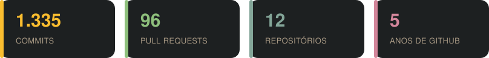

# 👋 Olá! Eu sou o Gabriel Oliveira

  

---

## 🚀 Tecnologias que eu uso no dia a dia

---

> 💻 Apaixonado por tecnologia e desenvolvimento de software. Estou sempre em busca de aprender novas ferramentas, criar soluções inovadoras e evoluir como desenvolvedor.
